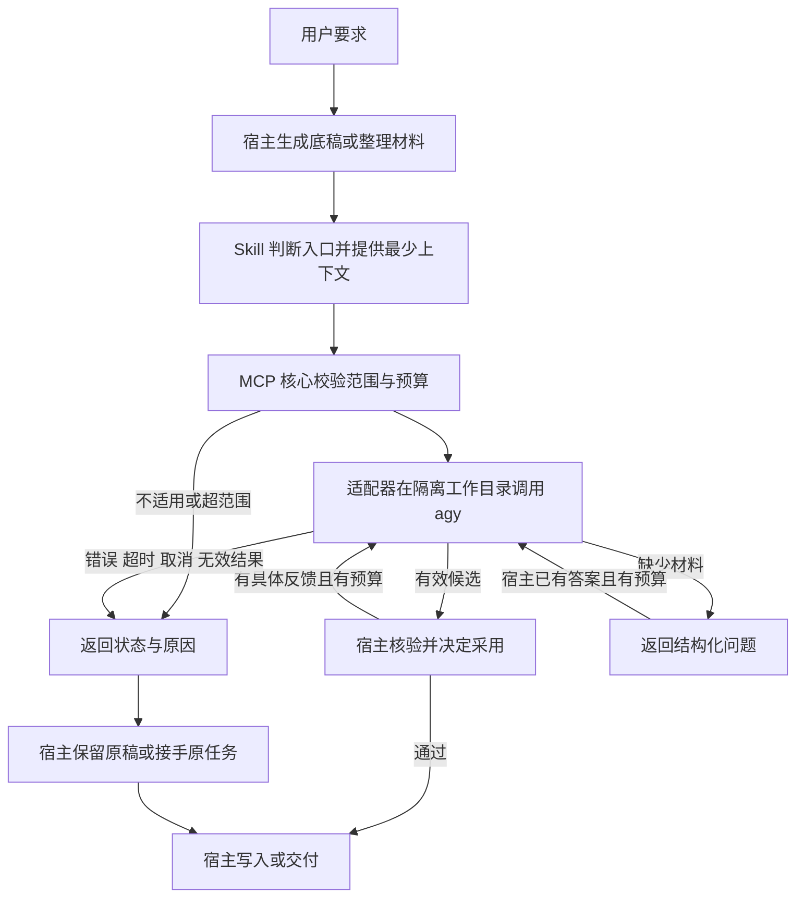

# Antigravity 通用委托与中文润色：首版设计

> 历史基线：本文件记录最初的纯文本范围。当前功能与状态以 README、工具契约及 2026-11-14-native-agy-delegation 设计为准；后续实施已加入搜索、原生委托和私有配置隔离。
日期：2026-11-14（Asia/Taipei）

状态：用户已授权首版实施；核心、适配器、Skills 和双宿主包已实现。全局/插件启动隔离验证尚未闭环，真实调用 gate 关闭；四宿主全面验收未完成。以 [验证记录](../../verification.md) 为实际状态依据。

关联：[实施计划](../plans/2026-11-14-antigravity-delegation.md)

## 1. 已确认目标与约束

本项目在 Codex / Cursor 内提供本地 Antigravity 委托能力。中文文档润色是默认自动场景；用户也可以明确要求 Antigravity 完成其他材料加工任务。宿主 Agent 始终负责组织任务、提供材料、评价结果及交付。

已确认要求：

1. Antigravity CLI、Antigravity、agy 均指同一工具；说明文使用 Antigravity CLI，可执行文件默认按 `agy` 查找。
2. 自动润色覆盖生成或修改的中文文档，以及明确要求撰写的中文长文；普通问答不触发。
3. 通用委托须有用户明确调用该工具的意图，包括命令入口和自然语言指令。
4. 润色是可选增强；失败须反馈原因、保留原稿并允许宿主继续，不以重试成功为交付条件。
5. 支持 Codex / Cursor 的桌面或编辑器场景，以及配套 CLI 中的便捷手动调用。
6. 已先整理设计与计划，后获用户授权实施；本轮不安装全局插件、不修改全局配置、不创建 commit。
7. 文件管理参考 `codex-model-switch-tool`，保持最小闭环和可维护的目录边界。

本文中的运行时选型、限额和内部命名属于工程设计选择，不是用户给出的业务数值。实施中若需要扩大权限、引入写操作、改变触发范围或失败行为，须按用户 AGENTS.md 说明影响与备选路径后确认。

## 2. 首版范围

| 场景 | 首版行为 | 最终责任 |
| --- | --- | --- |
| 中文文档润色 | 传入底稿、目的、读者、术语和约束，返回候选稿；允许有限反馈修订 | 宿主核验事实、结构和语义后采用 |
| 通用委托 | 对宿主传入的文字、代码片段、资料摘要进行分析、审阅、翻译、总结和候选内容生成 | 宿主核验结论及来源，不把候选代码自动执行 |
| 文件资料 | 宿主使用已有授权读取指定文件，把必要内容传入 | 不由 agy 自主扫描目录 |
| Word 等富文本文档 | 可润色宿主已提取的文字；专有格式的提取、回写和渲染仍由宿主处理 | 不承诺首版有独立二进制文档适配器 |
| 执行类请求 | 明确返回超出首版范围，宿主在原授权内接手 | 不执行文件修改、Shell、发布、提交或外部系统写入 |

首版不做通用多供应商框架、常驻后台任务平台、远程云端桥接、可视化管理页、全局输出拦截，也不自动安装或升级 agy。普通问答、代码生成过程中的每条中文解释、英文任务不会因出现中文字符就自动触发润色。

## 3. 证据与当前基线

| 对象 | 已核对事实 | 限制 |
| --- | --- | --- |
| 当前仓库 | `main`，无初始 commit；本轮起始为空工作区 | 没有可继承的业务实现 |
| 参考仓库 | `codex-model-switch-tool`，`main`，`51d6162a159bd996bdfdc0871bd26629674807ef`，工作区干净 | 只参考工程组织，不修改参考仓库 |
| Antigravity CLI | 本机 `agy 1.5.8`；help 包含 JSON、流式输入、指定会话、临时 settings | 暂不声明版本下限；用能力探测与已测版本矩阵约束 |
| Codex CLI | 本机 `0.169.0`，提供插件管理命令 | 未安装本插件验证 |
| Cursor | 编辑器 `3.30.8`；Cursor CLI `2026.11.11-043ef28`，help 提供 `--plugin-dir` | 编辑器和 CLI 分别验收，不互相代替 |
| 本地运行时 | Node.js `22.23.3`、pnpm `10.30.3` | 参考仓库固定 pnpm `10.33.0`；实施时通过项目固定版本，不擅自替换全局版本 |

2026-11-13 的调研调用仅使用虚构通知：流式同进程两轮均返回 `SUCCESS`，第一轮约 14 秒、两轮累计约 23 秒；另一次单轮结构化调用返回 `structured_output` 并退出 0。这是小样本连通证据，不是质量或性能基准。

已发现的风险：流式探测脚本在进程回收时出现 `PermissionError`，根因未闭环，不能据此确认 CLI 存在退出缺陷；另一样例增加了原稿未给出的理由，并改变了一处“预计”的确定程度。结构化调用的 `response` 同时包含正文和 JSON，消费者必须读取并校验 `structured_output`，不能假设 `response` 是干净 JSON。

参考仓库的证据入口：`README.md`、`package.json`、`.gitignore`、`scripts/package.py`、`.github/workflows/test.yml`、`plugin.json`、`mcp.json`、`docs/superpowers/plans/`。采用其锁文件、发行包白名单、跨平台测试及产物隔离方式；本项目使用单一 Node.js 运行时。

## 4. 方案选择

| 方案 | 共享能力 | 主要成本与限制 | 决定 |
| --- | --- | --- | --- |
| Skill + 脚本直调 | 可复用少量执行脚本 | 错误、会话、协议约定容易散入宿主指令 | 可作探测，不作为正式主路径 |
| Plugin + 两个 Skill + 本地 stdio MCP | 共享任务、CLI 适配、限额、错误与结果协议 | 维护两家宿主的打包及菜单兼容性 | 已选择的首版路线 |
| Hooks 为主拦截编辑和输出 | 可以观察更多事件 | 事后触发、上下文缺失、重复续跑，影响普通工作流 | 首版不启用自动执行 hooks |

将变化集中到三处：CLI 协议变化由适配器处理；写作规则变化由任务配置处理；插件清单和菜单变化由宿主适配处理。MCP 不负责自动获取整个聊天上下文，Skill 也不承担进程错误解析。

## 5. 交互入口与触发规则

### 5.1 手动入口

首版保留两个 Skill 名称：`agy`（通用委托）、`agy-polish`（中文润色）。

| 宿主 | 目标入口 | 文档依据 / 验收边界 |
| --- | --- | --- |
| Cursor Agent / Cursor CLI | `/agy <任务>`、`/agy-polish <要求>` | 官方支持技能斜杠菜单；完整名称是否带插件命名空间需实测 |
| Codex CLI | `$agy <任务>`、`$agy-polish <要求>`，或 `/skills` 选择 | 官方技能入口；不将任意自定义 `/agy` 写成已支持 |
| Codex 桌面端 | 技能选择或明确自然语言调用 | 按当前版本实际菜单验收，不假定与 CLI 完全同形 |

这些是宿主输入框中的快捷入口，不是 Shell 命令；不会注册或覆盖系统 `agy`。不通过废弃的自定义 prompt 机制强行模拟同名命令。

“请调用 antigravity cli / antigravity / agy 审阅下文”都表示同一显式委托。仅讨论或引用这些名字不触发。自然语言显式委托也须可用，因此不能简单设置一个只允许斜杠调用、同时屏蔽自然语言发现的宿主选项。

命令入口、自然语言入口、自动润色共用同一核心；宿主如有命名空间要求，仅改变显示语法，不复制任务逻辑。自动选中 Skill 依赖模型遵循指令，首版不保证所有文档百分之百触发。

### 5.2 中文润色判定

先判断用户是否要求文档或长文，再判断目标正文的主要语言。用户明确选择中文润色时以该意图优先；用户明确禁止外部润色时直接跳过。

自动调用时，宿主先提交文档任务类型。核心排除代码块、行内代码、链接地址和标记后，计算中文汉字占正文汉字与其他字母的比例；默认达到 50% 视为中文为主。该比率是可配置启发式，不是自然语言识别的质量承诺。无可处理正文或只含代码时跳过；不设置会漏掉短通知的固定字数门槛。

用户明确指定 agy 处理其他任务时使用通用委托，不再用中文比例过滤，也不强制输出中文。通用委托中的交付语言、语气和格式来自本次要求。

## 6. 主链路与责任



| 责任方 | 输入 | 输出 | 不承担的责任 |
| --- | --- | --- | --- |
| 宿主 Agent | 用户要求、授权资料、底稿 | 任务上下文、反馈、最终交付 | 不解析 CLI 原始事件 |
| 两个 Skill | 用户意图、当前写作或委托状态 | 规范调用、结果核验和降级说明 | 不自动扩大权限，不强制重试 |
| 委托核心 | 任务、范围、材料、期限 | 候选、问题、跳过或失败状态 | 不自主搜集聊天历史、不直接发布 |
| agy 适配器 | 提示、权限限制、指定会话 | 事件、结构化输出、诊断 | 不决定候选稿是否业务正确 |
| Antigravity CLI | 本次材料及有限会话上下文 | 文稿、分析或问题 | 不拥有最终文件写入权 |

宿主提供写作目的、读者、相关事实、术语、不可改动内容、预期交付格式；不传隐藏推理、无关聊天、全仓库和凭据。引用材料按数据处理，不能成为扩大工具权限的新指令。

## 7. 会话、输出与限额

### 7.1 会话管理

MCP 服务可以常驻；每轮 agy 调用使用短进程，向 `stream-json` stdin 写入一个 user 事件后关闭输入，解析输出直到本轮结果。反馈轮通过核心保存的明确 `conversation_id` 使用 `--conversation`，不使用全局 `--continue` 或“最近一次会话”。该组合须在实施探测中验证。

核心只向宿主返回不透明 session token，绑定当前 MCP 连接、工作区标识、宿主任务标识、任务配置与初始输入摘要。它是会话隔离标识，不是跨用户认证凭据；宿主不得直接指定底层 conversation ID。新任务、新工作区或重启后的未知 token 不自动接续。

同一请求标识且参数相同复用处理中或已完成结果；同标识不同参数返回冲突。自动润色对同任务、同正文与上下文摘要只尝试一次；失败后记为已尝试。显式要求重试时才允许带新的请求标识开始新委托，且说明这是新调用。不同文稿不能误用旧结果。

### 7.2 结果语义

- `candidate`：得到可供宿主审阅的候选，尚不代表最终交付完成。
- `needs_context`：返回有限的澄清问题。宿主已有答案时可续接；否则自动润色立即保留原稿，通用委托由宿主决定是否向用户提问。
- `skipped`：不符合触发范围、正文为空、已尝试或超出首版操作范围。
- `failed`：执行或结果验证失败，必须提供稳定错误类别及可展示原因。
- `cancelled`：用户或宿主取消；不自动恢复，不把取消解释为需要重试。

`candidate` 必须来自有效 `structured_output`，并通过本地 schema、大小及非空校验。`SUCCESS`、退出码 0 和正文流都不是充分条件；工具权限被拒绝也不能伪装成完成。部分输出只用于诊断，不作为合格候选。

### 7.3 工程默认值

以下为首版默认值，用户可在项目或插件配置中调整允许调整的项目；不改 agy 的全局 settings。

| 项目 | 默认及边界 |
| --- | --- |
| 总耗时预算 | 中文润色 30 秒，通用委托 60 秒；可配置 5–60 秒，覆盖启动、反馈轮和清理预留 |
| 最大轮数 | 共 2 轮，可配置为 1 或 2；追问和反馈均计入 |
| 失败自动重试 | 0 次 |
| 并发 | 每个 MCP 实例最多 2 个 agy 进程；超额立即返回 BUSY，不无界排队 |
| 输入 | 指令、正文和上下文序列化后合计最多 256 KiB UTF-8；超限不静默截断 |
| 输出 | 每轮 stdout 最多 1 MiB，stderr 最多 64 KiB；超限终止并返回原因 |
| 会话和去重记录 | 仅内存，空闲 15 分钟过期，最多 100 条；不淘汰运行中的任务，满额返回 BUSY |
| 清理 | 总预算内预留最多 2 秒；到期尝试终止本次所属进程，清理不能无限等待 |

预算从首次调用开始计算，宿主思考时间也占用后续续接窗口。候选成功返回后允许一次有针对性的反馈；失败、取消或过期的会话不能复活。宿主更短的工具超时或取消信号优先，不能通过调高预算绕过。

## 8. 中文内容保护与采用

中文润色必须保留事实、日期、数量、否定关系、前置条件、确定程度、术语和作者立场。默认保护代码块、行内代码、链接目标、占位符、YAML frontmatter 和宿主指定的原样片段。Markdown 结构解析使用标准解析能力，不用全局正则替换正文。

保护片段缺失或改变时拒绝候选并降级；数字和结构变化给出核验提示。纯机械检测不能证明“预计”没有变成承诺，宿主必须比较原稿与候选的语义。需要事实修正的内容返回给宿主判断，不由 agy 自行补写。

宿主采用前确认原稿版本仍与调用时一致；期间用户或其他 Agent 修改过的文档不直接覆盖，重新核对再处理。桥接不写目标文件，失败时不需要恢复目标文档。发布、发送或其他外部行为仍遵循原任务授权。

## 9. 失败降级与恢复

| 情况 | 桥接行为 | 宿主行为 |
| --- | --- | --- |
| 找不到可执行文件 / 缺少能力 | 返回 UNAVAILABLE / UNSUPPORTED_CAPABILITY，不自动安装或升级 | 保留原稿或继续原任务 |
| 登录、额度、网络或 CLI 失败 | 返回可识别原因，未知诊断归入 CLI_ERROR；不猜测“网络错误” | 简短说明，继续；不自动开启登录流程 |
| 权限不足或执行类请求 | 返回 PERMISSION_DENIED / SCOPE_UNSUPPORTED | 按原授权处理，不放宽 agy 权限 |
| 超时、进程挂起、输出超限 | 返回 TIMEOUT / OUTPUT_LIMIT，丢弃未验证输出，有限清理 | 不等待成功重试；迟到结果不得覆盖交付 |
| 输出不合法或破坏保护内容 | 返回 INVALID_OUTPUT / CONTENT_REJECTED | 中文润色使用原稿；通用委托由宿主接手 |
| 会话不匹配、重复参数冲突 | 返回 SESSION_MISMATCH / REQUEST_CONFLICT | 不接入其他任务；纠正调用不等于自动重跑 |
| 取消 | 返回 cancelled；取消优先于同时到达的结果 | 停止该增强步骤，遵从用户最新指令 |
| MCP 本身未启动 / 断开 | 桥接无法返回时由 Skill 处理宿主工具错误 | 同样降级；不得因没有结构化错误而反复调用 |

中文润色失败的用户提示示例：“Antigravity 润色超时，已保留原稿并继续完成文档。”不必把原始 stderr 或实现细节展示给用户。

通用委托默认允许宿主接手，但须说明结果来源。如果用户要求“必须由 agy 给出意见”，失败只能报告该委托未完成，不能把宿主自写结果标成 agy 结果；其他可独立工作仍可继续。

首版禁止 agy 执行外部副作用。如果探测发现权限限制失效，禁用该适配路径并返回错误，不宣称安全降级成功。未来加入写操作时必须新增“部分完成 / 结果未知”及变更核对、恢复责任，不能直接沿用纯文本重试。

## 10. 进程权限、配置与数据

默认使用明确配置的可执行路径或 PATH 中的 `agy`，通过固定参数数组启动，`shell: false`。不根据自然语言别名猜测或执行 `antigravity` 二进制；文稿通过 stdin 传递，不拼进 Shell 或命令行提示参数。

每个会话使用独立临时工作目录。利用 `--settings` 临时限制文件读取、文件写入、命令、Web 与 MCP 操作；禁止 `--dangerously-skip-permissions`。工具拒绝规则不能替代启动期自定义规则/插件隔离验证：须核对当前版本如何继承全局 customizations，并验证不会执行用户全局 hooks 或递归调用本插件。能力不能保证时返回不支持，不只依赖提示词。

候选返回前须确认本轮结构化结果、退出状态及必要清理均满足契约；收到正文后进程仍挂起，仍按剩余预算超时降级。若本次所属进程无法确认终止，则返回清理告警、禁用该 MCP 实例的新 agy 调用，防止泄漏累积；宿主原任务仍可继续。不得按进程名称清理其他 agy 会话。

配置只覆盖本插件参数；复用已有登录状态，不复制或展示凭据，不改变用户默认模型和权限。默认沿用 agy 当前模型，可通过插件配置显式指定；记录实际可确认的模型信息，未知时不编造。

桥接默认不落盘原稿、候选、聊天和原始 stderr；可记录脱敏错误类别、耗时、版本和请求标识。内存记录按过期或关闭清理。CLI 自身可能持久化会话及调用远端模型，这不受桥接的“不落盘”选项保证；安装说明必须披露，不能宣称文稿只在本机处理。

## 11. 文件组织与分发

运行时选型：Node.js 22+、TypeScript、pnpm 10.33.0、stdio MCP。pnpm 版本在项目 `packageManager` 固定；依赖精确解析写入 `pnpm-lock.yaml`。没有 Python 运行时需求。

```text
README.md
docs/superpowers/specs/        设计与决定
docs/superpowers/plans/        实施任务与验收映射
src/contracts.ts              核心类型和运行时 schema
src/config.ts                 默认值及有界配置
src/delegation/                会话、去重、预算、降级编排
src/antigravity/               能力探测、进程、事件解析与权限
src/workflows/                 中文润色和通用委托规则
src/mcp/server.ts             工具注册及协议映射
skills/agy/SKILL.md            显式通用委托
skills/agy-polish/SKILL.md     自动与手动中文润色
integrations/                 Codex / Cursor 打包模板与元数据
scripts/                      构建、打包、清单校验
tests/                        单元、进程、MCP、技能场景和包结构测试
.github/workflows/test.yml    无凭据自动检查
dist/                         构建产物，Git 忽略
release/                      两个宿主发行包，Git 忽略
```

当前只创建 README、本文和实施计划。进入实现后再按任务需要创建其他文件，不预建空目录。

共享 Skill 和核心只有一份源码。打包时分别生成宿主发行根目录的 `plugin.json`、MCP 清单和必要兼容清单；Codex 使用其支持的根目录变量，Cursor 使用 `${CURSOR_PLUGIN_ROOT}`，不得向 Cursor 原样复制 `${PLUGIN_ROOT}`。宿主清单版本从 `package.json` 单点生成；不加入无使用者的 hooks 空壳。

发行包按白名单收集运行文件、技能、许可证、说明与依赖声明；不含凭据、原稿、日志、测试输出、绝对开发路径或未需要的源码。禁止复制整个工作区打包。`.gitignore` 覆盖 node_modules、dist、release、缓存、日志、临时文件、真实配置和密钥；锁文件、示例配置和测试夹具可跟踪。

后续授权更新：用户已明确要求复制参考仓库的 MIT LICENSE，本项目现采用 MIT；这不构成 commit、push 或公开发布授权。

## 12. 验收与演进

| 编号 | 必须观察到的结果 |
| --- | --- |
| A1 | 中文文档/长文进入润色，普通问答及纯代码跳过；明确禁止外部润色优先 |
| A2 | 三种工具称呼和手动入口进入同一委托；仅讨论工具名称不触发 |
| A3 | 通用任务可按要求输出非中文内容，不继承润色的改写规则 |
| A4 | 候选可反馈一次，session 不串任务；过期、冲突、重复调用可识别 |
| A5 | 未安装、登录失败、错误、超时、无效输出及 MCP 故障均不阻塞原任务；失败不循环重试 |
| A6 | 工具调用被拒绝但进程退出 0 时不误报任务完成；权限隔离失效时禁用适配 |
| A7 | 取消、晚到结果、用户中途改稿、清理失败均不覆盖或污染已交付内容 |
| A8 | 代码、链接、占位符、数字和确定程度保护有自动检查与人工语义验证 |
| A9 | Codex 桌面、Codex CLI、Cursor 编辑器、Cursor CLI 分别完成加载、手动调用和故障降级验收 |
| A10 | 干净环境从锁文件构建、测试并打包；发行包可迁移，无凭据和开发机路径 |

自动测试使用模拟 agy，不依赖登录、不产生模型费用。真实测试用虚构材料并单独执行，记录宿主与 CLI 实际版本，不把模拟通过写成端到端通过。

中文质量使用至少 12 个固定样本：技术说明、操作通知、需求、评审意见、术语密集、中英混合、含代码/表格/链接、短文及长文等。任何新增事实或改变确定程度的样例必须被拒绝或由宿主纠正；语言偏好采用盲评记录，不预设 agy 一定优于原稿。

先验证能力隔离与进程生命周期，再实现共享核心、两个工作流和宿主入口。后续独立评估自主读文件、执行命令、写文件及后台长任务；这些都需要新增权限和恢复设计。本项目没有存量数据迁移，卸载插件即可停止新增委托；已由宿主采用并写入的文档不会因卸载自动回滚。

## 13. 官方依据

以下页面在本次设计阶段核对；在线文档会变化，实施仍须以已安装版本和实测为准。

- [Antigravity 非交互调用、会话、结构化输出及错误](https://antigravity.google/docs/cli/headless/)
- [Antigravity 权限](https://antigravity.google/docs/permissions/)
- [Codex 插件打包](https://developers.openai.com/plugins/build/plugins)
- [Codex 技能及显式调用](https://learn.chatgpt.com/docs/build-skills)
- [Codex 命令与 /skills](https://learn.chatgpt.com/docs/developer-commands?surface=cli)
- [Cursor 插件与路径变量](https://cursor.com/docs/plugins)
- [Cursor Skills](https://cursor.com/docs/skills)
- [Cursor 编辑器及 CLI 的 Skills 支持](https://cursor.com/changelog/2-4)
- [参考模式：OpenAI Codex plugin for Claude Code](https://github.com/openai/codex-plugin-cc)
